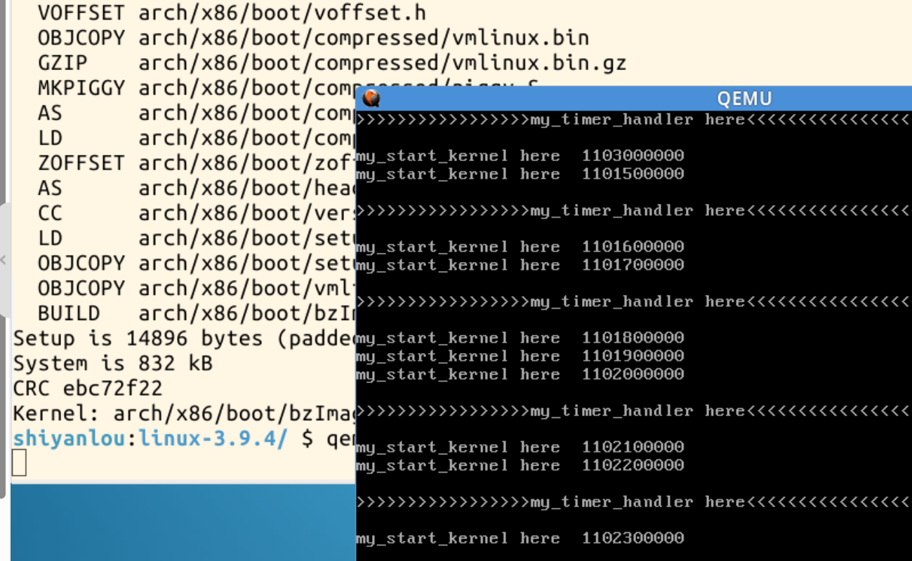
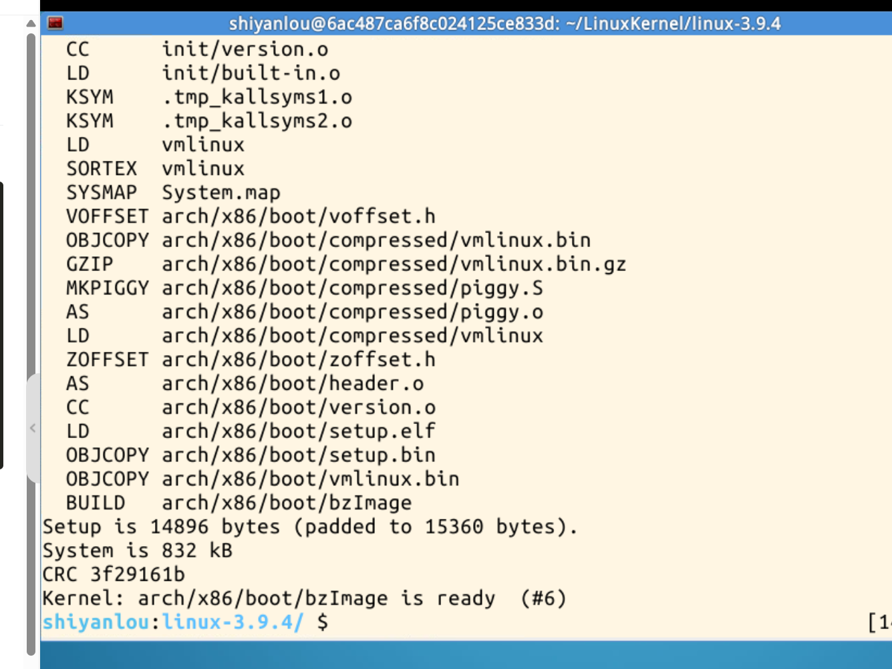
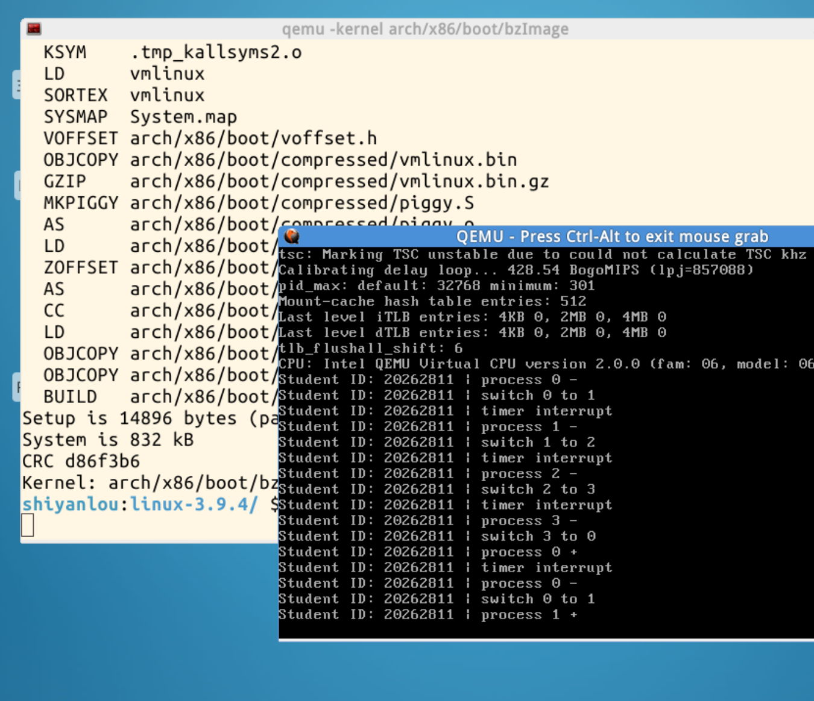

# 20262811《Linux内核原理与分析》第三周作业

## 一、学习中遇到的问题

在了解第三章的内核启动过程时，我不太清楚`start_kernel()`和实验中的`my_start_kernel()`有什么关系，因此借助ChatGPT进行提问。

通过解释，我了解到：`start_kernel()`负责组织Linux内核的初始化，建立内存、调度和中断等运行环境；`my_start_kernel()`是mykernel实验的入口，由补丁接入Linux的启动流程。这样就理解了为什么实验中的任务能够利用Linux已准备好的环境运行。

## 二、实验过程与结果

### 2.1运行基础内核

在实验楼网站的Linux环境中，按照实验指导给Linux 3.9.4应用mykernel补丁，编译并使用QEMU启动：

```bash
cd ~/LinuxKernel/linux-3.9.4
rm -rf mykernel
patch -p1 < ../mykernel_for_linux3.9.4sc.patch
make allnoconfig
make
qemu -kernel arch/x86/boot/bzImage
```

运行结果如下：



窗口中不断出现`my_start_kernel here ...`，并夹有周期性的`my_timer_handler here`。前者来自主程序的循环，后者来自时钟中断处理函数。中断处理结束后，主程序继续执行。

### 2.2时间片轮转内核代码与分析

采用[mykernel仓库对应版本](https://github.com/mengning/mykernel/tree/4b59d452b7812560151c5684ce9a07bcaddb3127)的参考实现。三个主要文件的完整实验代码如下。

#### （1）mypcb.h

```c
/*
 * linux/mykernel/mypcb.h
 * Copyright (C) 2013 Mengning
 */
#define MAX_TASK_NUM        4
#define KERNEL_STACK_SIZE   1024*8

struct Thread {
    unsigned long ip;
    unsigned long sp;
};

typedef struct PCB {
    int pid;
    volatile long state;
    char stack[KERNEL_STACK_SIZE];
    struct Thread thread;
    unsigned long task_entry;
    struct PCB *next;
} tPCB;

void my_schedule(void);
```

`mypcb.h`定义任务控制块`tPCB`。`pid`标识任务编号，`stack`为每个任务提供独立的8 KiB栈；`thread.ip`保存入口地址或恢复位置，`thread.sp`保存栈指针；`next`指向下一个任务。

#### （2）mymain.c

```c
/*
 * linux/mykernel/mymain.c
 * Copyright (C) 2013 Mengning
 */
#include <linux/types.h>
#include <linux/kernel.h>
#include <linux/init.h>
#include <linux/string.h>
#include <linux/ctype.h>
#include <linux/tty.h>
#include <linux/vmalloc.h>
#include "mypcb.h"

tPCB task[MAX_TASK_NUM];
tPCB *my_current_task = NULL;
volatile int my_need_sched = 0;

void my_process(void);

void __init my_start_kernel(void)
{
    int pid = 0;
    int i;

    /* Initialize process 0 */
    task[pid].pid = pid;
    task[pid].state = 0;
    task[pid].task_entry = task[pid].thread.ip =
        (unsigned long)my_process;
    task[pid].thread.sp =
        (unsigned long)&task[pid].stack[KERNEL_STACK_SIZE-1];
    task[pid].next = &task[pid];

    /* Create the other processes */
    for(i = 1; i < MAX_TASK_NUM; i++)
    {
        memcpy(&task[i], &task[0], sizeof(tPCB));
        task[i].pid = i;
        task[i].state = -1;
        task[i].thread.sp =
            (unsigned long)&task[i].stack[KERNEL_STACK_SIZE-1];
        task[i].next = task[i-1].next;
        task[i-1].next = &task[i];
    }

    /* Start process 0 */
    pid = 0;
    my_current_task = &task[pid];
    asm volatile(
        "movl %1,%%esp\n\t"
        "pushl %1\n\t"
        "pushl %0\n\t"
        "ret\n\t"
        "popl %%ebp\n\t"
        :
        : "c" (task[pid].thread.ip),
          "d" (task[pid].thread.sp)
    );
}

void my_process(void)
{
    int i = 0;
    while(1)
    {
        i++;
        if(i % 10000000 == 0 && my_need_sched == 1)
        {
            printk(KERN_NOTICE "Student ID: 20262811 | process %d -\n",
                   my_current_task->pid);
            if(my_need_sched == 1)
            {
                my_need_sched = 0;
                my_schedule();
            }
            printk(KERN_NOTICE "Student ID: 20262811 | process %d +\n",
                   my_current_task->pid);
        }
    }
}
```

`my_start_kernel()`先初始化任务0，再通过`memcpy`初始化其他任务，并分别设置编号和栈指针。任务通过`next`连接成环，顺序为`0 → 1 → 2 → 3 → 0`。虽然四个任务使用同一个`my_process()`入口，但各自拥有独立的栈，可以保存自己的局部变量和函数调用现场。

本例中，任务0的初始状态为`0`，其他任务为`-1`；后者首次启动时被设为`0`。调度器据此选择首次启动或恢复运行分支。这是示例中的简化状态管理。

启动任务0时，先让`my_current_task`指向它，再通过`movl %1,%%esp`使用任务0的栈，将入口地址压入栈中，最后执行`ret`。`ret`从栈顶取出地址作为新的执行位置，从而进入`my_process()`。

`my_process()`在循环中检查该标志，发现需要调度便清除标志并调用`my_schedule()`。因此，本例的执行关系是“时钟中断提出请求 → 返回任务 → 任务检查标志 → 执行调度”，实际切换发生在任务的检查点。

#### （3）myinterrupt.c

```c
/*
 * linux/mykernel/myinterrupt.c
 * Copyright (C) 2013 Mengning
 */
#include <linux/types.h>
#include <linux/kernel.h>
#include <linux/string.h>
#include <linux/ctype.h>
#include <linux/tty.h>
#include <linux/vmalloc.h>
#include "mypcb.h"

extern tPCB task[MAX_TASK_NUM];
extern tPCB *my_current_task;
extern volatile int my_need_sched;

volatile int time_count = 0;

/* Called by timer interrupt */
void my_timer_handler(void)
{
    if(time_count % 1000 == 0 && my_need_sched != 1)
    {
        printk(KERN_NOTICE
               "Student ID: 20262811 | timer interrupt\n");
        my_need_sched = 1;
    }
    time_count++;
}

void my_schedule(void)
{
    tPCB *next;
    tPCB *prev;

    if(my_current_task == NULL ||
       my_current_task->next == NULL)
    {
        return;
    }

    next = my_current_task->next;
    prev = my_current_task;

    if(next->state == 0)
    {
        my_current_task = next;
        printk(KERN_NOTICE
               "Student ID: 20262811 | switch %d to %d\n",
               prev->pid, next->pid);

        /* Resume a process that has run before */
        asm volatile(
            "pushl %%ebp\n\t"
            "movl %%esp,%0\n\t"
            "movl %2,%%esp\n\t"
            "movl $1f,%1\n\t"
            "pushl %3\n\t"
            "ret\n\t"
            "1:\t"
            "popl %%ebp\n\t"
            : "=m" (prev->thread.sp),
              "=m" (prev->thread.ip)
            : "m" (next->thread.sp),
              "m" (next->thread.ip)
        );
    }
    else
    {
        next->state = 0;
        my_current_task = next;
        printk(KERN_NOTICE
               "Student ID: 20262811 | switch %d to %d\n",
               prev->pid, next->pid);

        /* Start a process for the first time */
        asm volatile(
            "pushl %%ebp\n\t"
            "movl %%esp,%0\n\t"
            "movl %2,%%esp\n\t"
            "movl %2,%%ebp\n\t"
            "movl $1f,%1\n\t"
            "pushl %3\n\t"
            "ret\n\t"
            "1:\t"
            "popl %%ebp\n\t"
            : "=m" (prev->thread.sp),
              "=m" (prev->thread.ip)
            : "m" (next->thread.sp),
              "m" (next->thread.ip)
        );
    }
}
```

**时钟中断与调度**

`my_timer_handler()`每次被调用时增加`time_count`。当计数为1000的倍数且没有待处理的请求时，设置`my_need_sched = 1`。计数从0开始，因此第一次调用也可能满足条件；这里的1000是中断调用计数，不是直接表示一秒。

调度器使用`my_current_task->next`选择下一个任务。环形链表使每个任务依次获得运行机会，形成简单的轮转调度。

**首次启动与上下文恢复**

首次启动任务1、2、3时，它们尚未保存过暂停现场，因此使用`thread.ip`中的入口地址和初始栈。调度器在保存旧任务现场后，通过`movl %2,%%esp`、`movl %2,%%ebp`设置新任务的栈，再压入入口地址并执行`ret`。

首次启动进入任务函数的开头；恢复运行则回到任务上次暂停的位置，这也是两个切换分支的主要区别。

切换代码中的`%0`、`%1`对应旧任务的`thread.sp`、`thread.ip`，`%2`、`%3`对应下一个任务的这两个字段。核心指令的作用如下：

| 指令 | 作用 |
| --- | --- |
| `pushl %%ebp` | 将旧任务的栈帧指针保存到其栈中 |
| `movl %%esp,%0` | 保存旧任务当前的栈指针 |
| `movl %2,%%esp` | 切换到下一个任务的栈 |
| `movl $1f,%1` | 保存旧任务将来的恢复位置 |
| `pushl %3`、`ret` | 跳转到下一个任务的入口或恢复位置 |
| `1:`、`popl %%ebp` | 任务恢复时到达该标号，并恢复栈帧指针 |

`1f`表示向前寻找数字标号`1`。旧任务保存这个地址后，以后再次获得运行机会时会从该位置继续执行，完成原来的`my_schedule()`调用，再返回自己的任务循环。

### 2.3编译与运行结果

重新编译并启动内核：

```bash
make
qemu -kernel arch/x86/boot/bzImage
```

编译成功，生成可供QEMU启动的内核镜像：



运行后可以观察到四个任务的循环切换：



从截图中提取切换日志，省略中间的其他输出：

```text
Student ID: 20262811 | switch 0 to 1
Student ID: 20262811 | switch 1 to 2
Student ID: 20262811 | switch 2 to 3
Student ID: 20262811 | switch 3 to 0
Student ID: 20262811 | switch 0 to 1
```

任务完成一次`0 → 1 → 2 → 3 → 0`的轮转后，继续切换到任务1，实验结果符合预期。

截图中的以下输出可以验证恢复过程：

```text
Student ID: 20262811 | process 3 -
Student ID: 20262811 | switch 3 to 0
Student ID: 20262811 | process 0 +
```

任务0之前在调度调用中被切走。任务3切回任务0后，任务0从原调度调用中返回，继续执行后面的打印语句，因此出现`process 0 +`。这里的`-`和`+`分别是调度调用前后的日志标记。

## 三、操作系统是怎样工作的

通过本次实验，我认识到，任务能够暂停后继续运行，关键在于保存并恢复它的执行现场。任务控制块记录恢复地址和栈指针，独立的任务栈保存调用关系与局部现场；切换这些信息后，处理器就能继续执行另一个任务。

时钟中断提供周期性的调度机会，调度器决定下一个任务，上下文切换完成控制流的转移。最终四个任务按固定顺序循环运行，并能从原来的调度调用后继续执行，使“操作系统如何让多个任务轮流运行”变得直观。本实验展示的是简化的内核任务调度，真实Linux的进程管理还包含地址空间、更多处理器状态及复杂调度策略。


